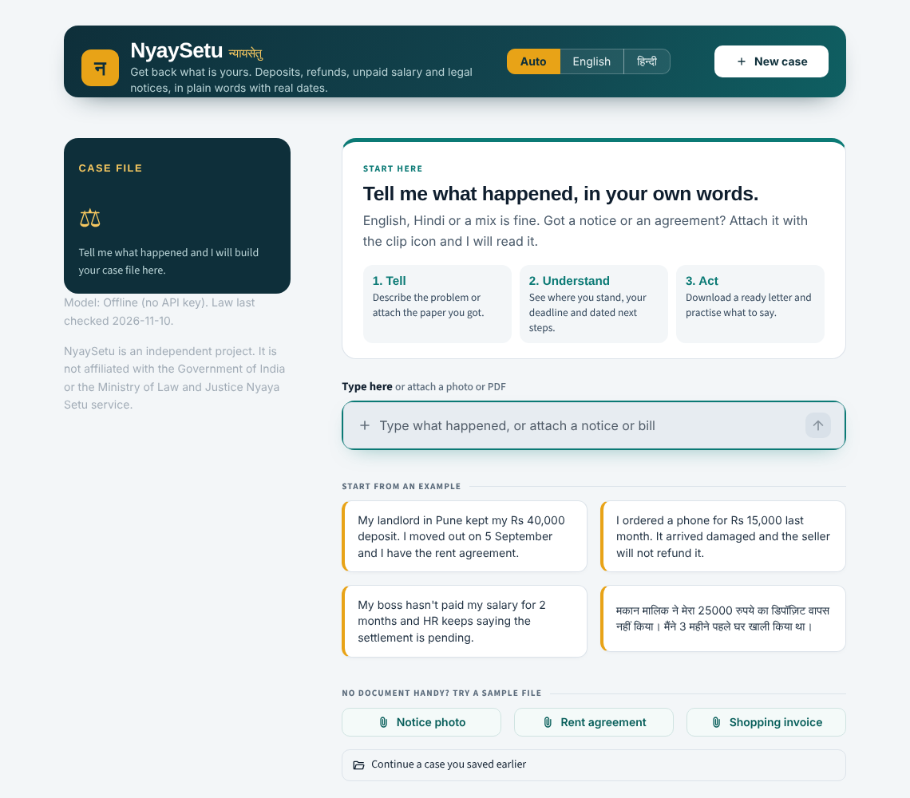
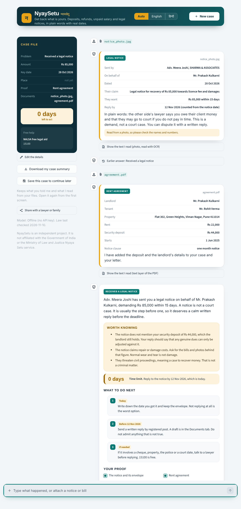

# NyaySetu

An independent project. Not affiliated with the Government of India or the Ministry of Law and Justice Nyaya Setu service.

A legal helper for four everyday problems in India: a deposit your landlord won't return, a refund that never came, salary that stopped, and a legal notice you don't understand.

Type what happened in English, Hindi or a mix, or attach the paper you were given. It reads notices, rent agreements and bills (PDF, Word, or a phone photo), asks for anything still missing, then tells you where you stand, works out your deadline, gives you dated next steps and drafts the letter with your details already filled in.



## Run it

```bash
cd ai-lawyer
python3 -m venv .venv && source .venv/bin/activate
pip install -r requirements.txt
streamlit run app.py
```

No API key needed. Everything, including reading photos, works offline. It is built for Streamlit 1.60 or newer, but older versions (tested down to 1.39) still run: files are then attached with a separate picker under the chat box. The first photo you attach takes a few seconds while the OCR model loads.

## What you can do in the chat

1. Describe the problem in your own words. If it is vague, it asks which of the four problems it is, with a Something else option that points you to NALSA.
2. Attach a document with the clip icon, or try one of the three samples on the first screen. It shows you what it read, explains it in plain words and adds the names, amounts and dates to your case and your letter.
3. Attach more than one. A landlord's notice plus your rent agreement gives you a warning that the notice ignores your deposit, and your reply is drafted to say so.
4. Ask follow up questions (do I need a lawyer, can he cut painting charges, what if they ignore me). Answers come from a checked FAQ, never from a guess.
5. Correct anything (actually it was 45k) or use Edit the details in the case file. Dates and deadlines are worked out again.
6. Raise a different problem mid chat and it offers to open a new case. Things it does not handle, like cyber fraud, violence, divorce or land disputes, are sent to the right helpline instead.
7. Download the letter as a Word file and a one page case summary, and practise answering the other side.
8. Under every answer: Read aloud (the browser's own voice, English or Hindi, works offline), Add to calendar (an .ics file with each dated step and the last day to act, with reminders), Share on WhatsApp, and a thumbs up or down.
9. Save this case downloads a small file. Open it from the first screen days later and the dates are worked out again for that day. Nothing is stored on a server.



## How it keeps the law right

Every legal statement comes from `data/knowledge_base.yaml`: 12 facts, each with the statute and section, plain English and Hindi text, and a source note. Follow up answers come from `data/faq.yaml`. I last checked both against the bare Acts and government portals on 10 Nov 2026.

Offline, answers are built only from those files. If you connect a model, it may reword the opening summary and answer questions the FAQ does not cover, and `core/guard.py` deletes any sentence that cites a section or Act not in the knowledge base. Dates and deadlines are always computed in code.

## Put it online for free (Streamlit Community Cloud)

1. Make a new GitHub repository and push this folder to it. `packages.txt` installs the two system libraries the photo reader needs.
2. Go to share.streamlit.io, sign in with GitHub and choose Create app.
3. Pick the repository, branch `main` and main file `app.py`. Under Advanced settings choose Python 3.12.
4. Deploy. The first build takes a few minutes. The link it gives you is the prototype link.

Ratings from the thumbs buttons are written to `feedback/feedback.jsonl`. On the free cloud that folder is wiped whenever the app restarts, so it is for a demo, not for keeping data.

## If a document is not read

Run this with the same Python that runs the app. It lists which readers are installed and prints what the app reads from each file:

```bash
python tools/check_files.py path/to/notice.pdf
```

In the app, every document card also has a Show the text I read section with the raw text and how it was read.

## Tests

```bash
python3 tests/run_tests.py
```

Runs 36 conversations: Hindi, Hinglish, vague openings, skipped questions, every red flag, false alarm traps, a planted fake citation, attached PDFs and photos, a pasted notice, a broken file, corrections, follow up questions, out of scope problems and switching cases. It writes transcripts and Word drafts to `raw_outputs/`. Current result: 268/268 checks.

## Connect a model (optional)

```bash
export LLM_PROVIDER=openai
export OPENAI_API_KEY=...
export OPENAI_MODEL=gpt-4o-mini        # or any model on your endpoint
export OPENAI_BASE_URL=https://...      # optional, any OpenAI compatible API
```

`core/llm.py` is the only file that talks to a model. With a model connected you also get voice input, answers to open questions and free practice against the other side.

## Layout

```
app.py                 Streamlit app
core/conversation.py   the chat: asks for missing facts, answers, handles questions, corrections and files
core/reader.py         reads PDFs, Word files and photos (offline OCR), and pulls out names, dates and amounts
core/intake.py         reads amounts, dates, proof and city from free text
core/advise.py         builds the answer, deadlines, dated steps and cross document warnings
core/faq.py            matches follow up questions to checked answers
core/escalate.py       red flags that send you to a real lawyer
core/guard.py          removes any citation not in the knowledge base
core/documents.py      legal notice, reply to a notice, consumer complaint, case summary (.docx)
core/practice.py       plays the other side and checks your reply
data/                  knowledge base and FAQ
samples/               a sample notice (PDF and photo), rent agreement and invoice, all made up
ui/                    styles and HTML for the app
tests/                 test conversations, fixtures and runner
```

NyaySetu gives general legal information, not legal advice. For free legal aid call NALSA on 15100.
